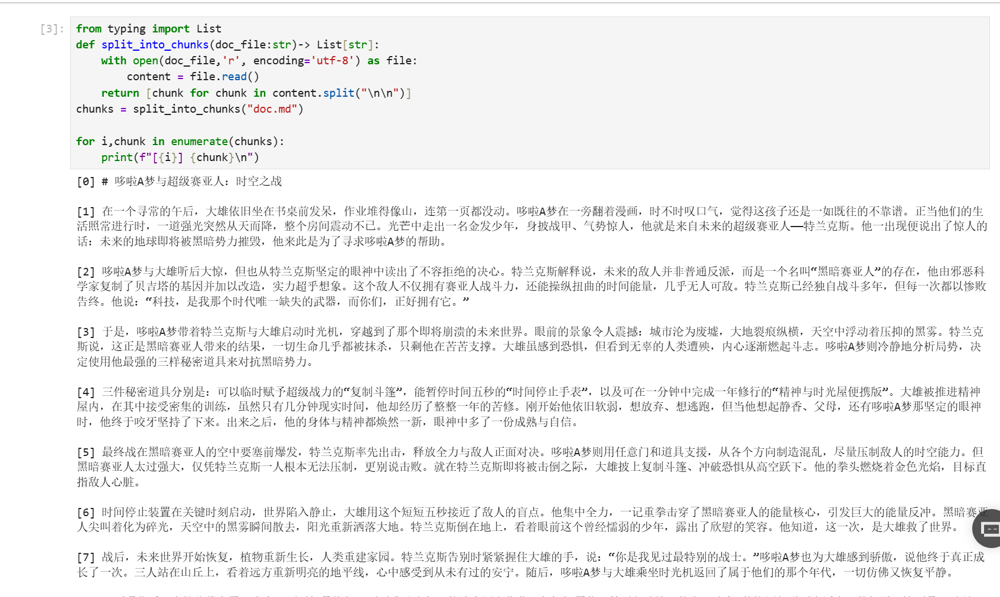
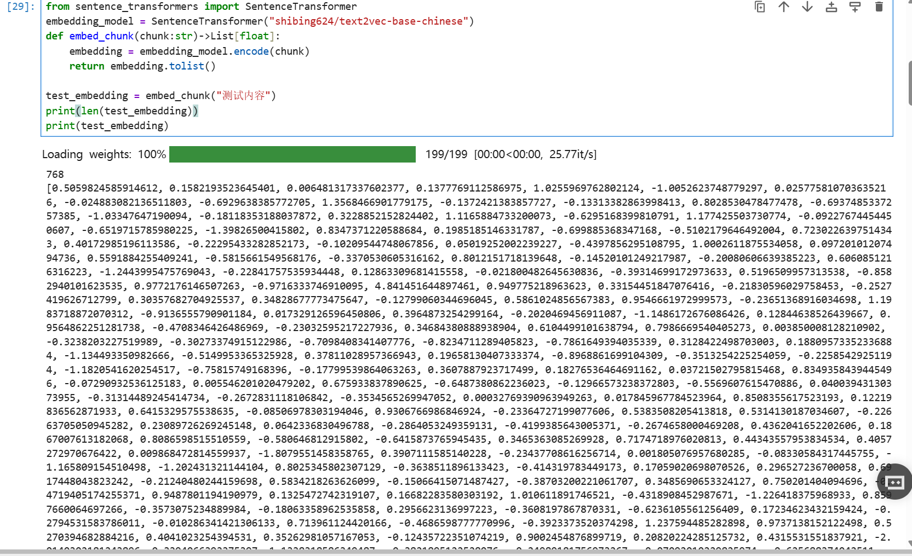
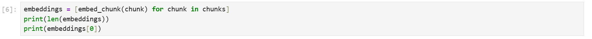
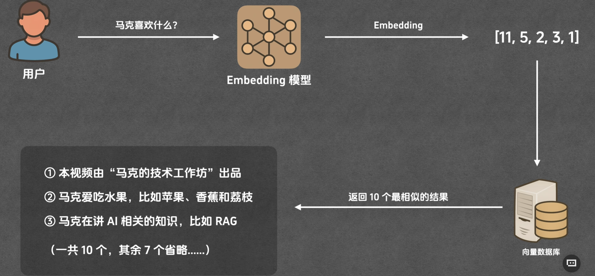
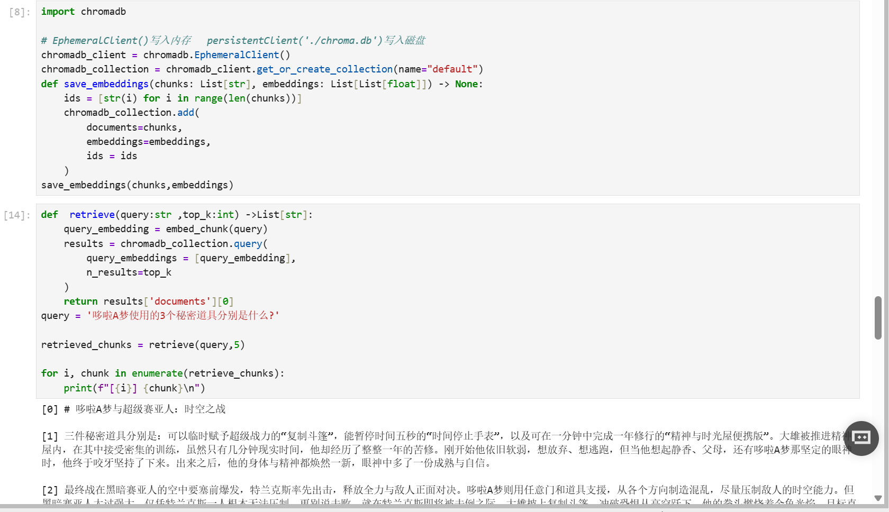
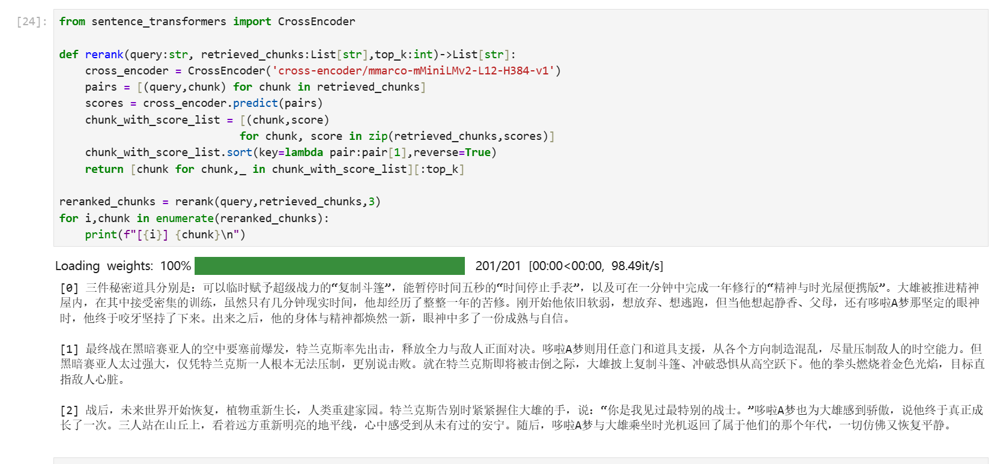
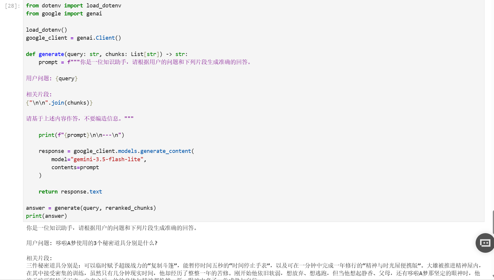
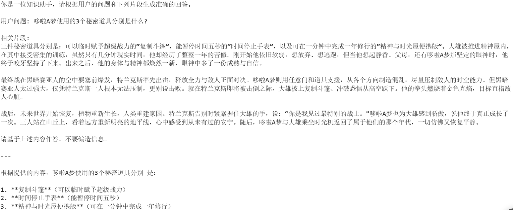

# 什么是 RAG？

RAG（Retrieval-Augmented Generation，检索增强生成）是一种让大模型结合外部资料回答问题的方法：先从知识库中检索相关内容，再将这些内容作为上下文交给大模型，由模型组织答案。

可以把它理解为一次“开卷问答”：系统先查找资料，再结合资料回答问题。例如，用户询问某个产品的退款规则时，系统可以先检索产品文档，再根据文档中的条款生成回答。

## RAG 的使用场景

当回答需要依赖特定资料时，RAG 就能派上用场。常见场景包括：

- **知识库问答**：基于内部文档、操作手册或技术资料回答问题。
- **智能客服**：结合产品说明、常见问题和业务规则提供解答。
- **信息检索与整理**：从多份资料中查找相关内容，并生成便于阅读的答案。

## 基本流程

本文以向量检索为例，将 RAG 流程分为两个阶段：

- **准备阶段**：文档 → 分片 → 向量化与建立索引。
- **问答阶段**：用户提问 → 召回 → 重排（可选）→ 生成答案。

准备阶段通常在导入或更新资料时执行；问答阶段则在用户提交问题后执行。下面按照这条流程，逐步说明每个环节的作用。

### 1. 分片：把文档拆成便于检索的片段

首先，将文档切分成多个片段（Chunk）。这样既方便检索到具体内容，也能控制后续传给模型的上下文长度。

常见的分片方式有：

- **按章节或段落分片**：利用文档结构，尽量保留完整的语义。
- **按句子分片**：以句子为单位切分，或将相邻句子组合成一个片段。
- **按字符数或 Token 数分片**：按设定的长度切分，便于控制片段大小。
- **按页码分片**：适用于 PDF 等分页文档，但需要留意跨页内容是否被截断。

分片大小需要结合资料特点调整：片段太短，可能缺少上下文；片段太长，又可能夹杂较多无关信息。也可以让相邻片段保留少量重叠内容，减少切分边界造成的信息丢失。

下面是文档分片的代码示例：



### 2. 索引：让文档片段可以被快速检索

分片完成后，使用 Embedding 模型将每个片段转换为向量，再将向量与对应的原文一起存入支持向量检索的数据库，并建立索引。实际应用中，还可以保存文档标题、来源、页码等元数据，方便后续定位和引用。

#### 如何理解向量？

在这里，向量可以理解为一组表示文本特征的数字，例如：

```text
[1.0, 2.0, 3.0]
```

这个三维向量只是示意。实际的文本向量通常有更多维度，由 Embedding 模型生成。在同一模型的向量空间中，语义相近的文本通常具有较高的向量相似度，因此可以通过比较向量来查找相关内容。

下面是生成文本向量的代码示例：



对所有片段执行向量化后，可以查看向量数量及其中一个片段的向量：



### 3. 召回：找出可能与问题相关的片段

用户提交问题后，系统先用与文档向量兼容的 Embedding 模型将问题转换为向量，再从索引中检索相似度较高的片段，作为候选资料。

检索时通常会设置 `top_k`，表示返回的候选片段数量。例如，`top_k = 5` 表示取回排名靠前的 5 个片段。召回阶段的目标是尽可能找到有用资料，这些候选片段还需要进一步筛选。

下图展示了召回过程：



下面的代码将片段及其向量写入 Chroma，再根据用户问题检索候选片段：



### 4. 重排：进一步筛选候选资料

召回结果中可能包含主题相近、却无法直接回答问题的片段。为了让更有用的内容排在前面，可以增加重排（Rerank）步骤。

一种常见做法是使用 Cross-Encoder 模型：将“用户问题”和“候选片段”成对输入模型，计算相关性得分，再根据得分重新排序。

相比预先计算文档向量、再进行相似度检索的方式，Cross-Encoder 通常需要更多计算，但往往能更细致地判断问题与片段的关系。因此，它适合处理召回后的少量候选内容。具体原理可以参考 [Sentence Transformers 的 Cross-Encoder 文档](https://www.sbert.net/examples/cross_encoder/applications/README.html)。

重排是可选步骤，需要根据实际效果、响应时间和计算成本决定是否采用。



### 5. 生成：结合参考资料组织答案

最后，将用户问题、筛选后的参考资料以及回答要求一起组成提示词，发送给大模型，由模型生成答案。

提示词中可以明确要求模型优先依据参考资料回答；如果资料不足，就说明无法从现有资料中确定答案。有来源信息时，也可以要求模型标注引用，方便用户核对。





RAG 能为回答提供资料依据，但仍可能出现检索遗漏或生成错误。实际效果需要结合分片质量、检索结果和最终答案共同评估。关于 RAG 的阶段划分与实现方式，也可以参考 [LangChain4j 的 RAG 文档](https://docs.langchain4j.dev/tutorials/rag/)。
